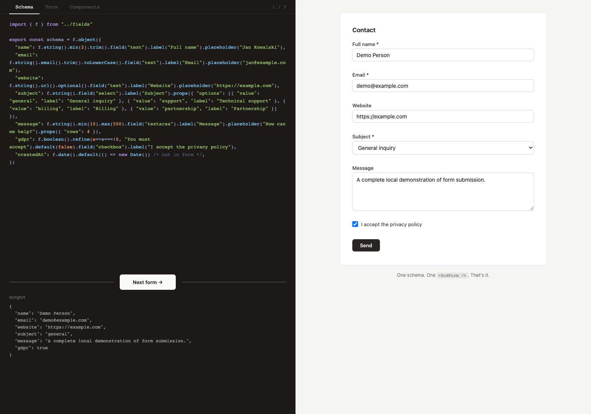

<div align="center">

# zod2form

**Your Zod schema is your React form.**

Typed schemas, your own field components, and React Hook Form underneath.<br />
Use Zod 3 or Zod 4. Keep full control of the interface.

[](https://www.npmjs.com/package/zod2form)
[](#cheatsheet)
[](#quick-start)
[](LICENSE)

[Live demo](https://dawidw5219.github.io/zod2form/) · [Quick start](#quick-start) · [Advanced](#advanced)

</div>



## Quick start

```bash
npm install zod2form zod
```

Requires React 18 or later. Register a field component, describe the form, and render it:

```tsx
import { defineFields, ZodForm, type FieldProps } from "zod2form"

function TextInput({ label, name, value, onChange, onBlur, error }: FieldProps) {
  return (
    <label>
      {label}
      <input name={name} value={String(value ?? "")} onChange={onChange} onBlur={onBlur} />
      {error && <span role="alert">{error}</span>}
    </label>
  )
}

const fields = defineFields({ text: TextInput })
const schema = fields.object({
  email: fields.string().email().field("text").label("Email"),
})

export function ContactForm() {
  return (
    <ZodForm schema={schema} fields={fields} onSubmit={data => console.log(data)}>
      <button type="submit">Send</button>
    </ZodForm>
  )
}
```

That is the complete example. The component is yours; zod2form connects its value, validation and events. Reuse the registry as you add more forms.

## Advanced setup

Split a larger integration into reusable field components, a registry and schemas:

### 1. Write your field components

zod2form does not ship any UI — you write your own components once and reuse them across every form. Each component receives a standard `FieldProps` payload:

```tsx
// components.tsx
import type { FieldProps } from "zod2form"

export function TextInput({ label, error, isRequired, value, onChange, onBlur, name, placeholder }: FieldProps) {
  return (
    <label>
      {label}{isRequired && " *"}
      <input name={name} value={String(value ?? "")} onChange={onChange} onBlur={onBlur} placeholder={placeholder} />
      {error && <span>{error}</span>}
    </label>
  )
}

export function Checkbox({ label, error, value, onChange, onBlur }: FieldProps) {
  return (
    <label>
      <input type="checkbox" checked={!!value} onChange={e => onChange(e.target.checked)} onBlur={onBlur} />
      {label}
      {error && <span>{error}</span>}
    </label>
  )
}
```

### 2. Register them

```tsx
// fields.ts
import { defineFields } from "zod2form"
import { TextInput, Checkbox } from "./components"

export const f = defineFields({ text: TextInput, checkbox: Checkbox })
```

`defineFields()` returns a typed form builder. Use `f.string()`, `f.object()`, etc. to build schemas — `.field()` autocompletes only your registered field types. Pass the same `f` as `fields` to `<ZodForm />`.

### 3. Define a schema

```tsx
// schemas/contact.ts
import { f } from "../fields"

export const schema = f.object({
  name:  f.string().min(2).field("text").label("Full name").placeholder("Jan Kowalski"),
  email: f.string().email().field("text").label("Email").placeholder("jan@example.com"),
  gdpr:  f.boolean().refine(v => v === true, "Required").field("checkbox").label("I accept the privacy policy").default(false),
})
```

### 4. Render the form

```tsx
// contact-form.tsx
import { ZodForm } from "zod2form"
import { f } from "./fields"
import { schema } from "./schemas/contact"

export function ContactForm() {
  return (
    <ZodForm
      schema={schema}
      fields={f}
      onSubmit={(data) => console.log(data)}
    >
      <button type="submit">Send</button>
    </ZodForm>
  )
}
```

The builder forwards Zod's methods, so schema validation and parsing work with Zod 3 and Zod 4 methods such as `.min()`, `.email()`, `.optional()`, `.refine()`, `.regex()`, `.url()`, and `.date()`. You add form metadata with chains: `.field("type")`, `.label("text")`, `.placeholder("text")`, `.hint("text")`, `.props({ ... })`, `.autoComplete("email")`. Fields without `.field()` are not rendered.

`ZodForm` renders your registered components, wires up react-hook-form with the package's Zod 3/4 resolver, and handles validation. It scans the top-level `schema.shape`; nested objects, arrays, unions, and other complex values can still be validated by Zod, but are not automatically expanded into separate form controls. Empty required fields show "Required" automatically. Default mode is `onTouched`.

### Error messages and translations

`ZodForm` uses short English defaults. Override individual messages with `dict`, provide a complete typed translation, or connect an i18next-style translator with `t`:

```tsx
<ZodForm
  schema={schema}
  fields={f}
  onSubmit={handleSubmit}
  dict={{
    required: "Required field",
    "string.min": "Use at least {{minimum}} characters",
  }}
>
  <button type="submit">Send</button>
</ZodForm>
```

Instead of `dict`, pass `t={(key, params) => i18next.t(\`zod.${key}\`, params)}`.

For complete control, pass `errorMap={(issue) => ({ message: "..." })}`. The same resolver also handles schemas created with either Zod 3 or Zod 4.

## Live demo

See it running with real components, validation, and multiple form shapes:

[→ Open the live demo](https://dawidw5219.github.io/zod2form/)

The Schema tab shows executable schema code generated from the current example, including validations, defaults, enum values, field metadata, and select option values. The demo generator supports native Zod 3 and Zod 4 schema internals. A callback passed to `.refine()` on an already-created plain Zod 3 schema cannot be recovered from runtime introspection; the generator marks that case with an explicit warning instead of silently dropping it.

## Advanced

### react-hook-form access

`ZodForm` wraps your form in `FormProvider`. Use hooks from `zod2form`:

```tsx
import { useZodFormContext, useWatch } from "zod2form"

function SubmitButton() {
  const { formState } = useZodFormContext()
  return <button disabled={formState.isSubmitting}>Send</button>
}

function LivePreview() {
  const data = useWatch()
  return <pre>{JSON.stringify(data, null, 2)}</pre>
}
```

All react-hook-form hooks re-exported: `useFormContext`, `useWatch`, `useFormState`, `useFieldArray`, `useController`, `FormProvider`. `useZodFormContext()` adds `fieldsMeta` with schema metadata.

### react-hook-form options

All `useForm()` options forwarded:

```tsx
<ZodForm
  schema={schema}
  fields={f}
  onSubmit={handleSubmit}
  mode="onChange"
  defaultValues={{ name: "Jan" }}
  shouldFocusError={false}
/>
```

## Cheatsheet

| Export | What it does |
|---|---|
| `defineFields()` | Register field components, get a typed form builder |
| `ZodForm` | Render a form from schema + field registry |
| `useZodFormContext()` | `useFormContext()` + schema metadata |
| `FieldProps` | Props type for field components |

For inferred parsing results, use `schema.toZod().parse(data)`. The form builder narrows registered field names; the `onSubmit` callback currently receives React Hook Form’s `FieldValues`.

## Development

```bash
bun install
bun run demo        # Local demo
bun run build       # Types, tests, library and GitHub Pages demo
bun run check:package
```

The demo imports the current library source and bundles its syntax highlighter locally. It does not need a CDN to render. Tests live in `tests/`.

```bash
bun run deploy      # Build, package checks, GitHub + Pages, then npm
```

Requires authenticated `gh` and `npm`, plus `ghdeploy`. Review the selected release version before publishing. GitHub Pages is served from the `gh-pages` branch generated from `example/dist`.

## License

MIT
